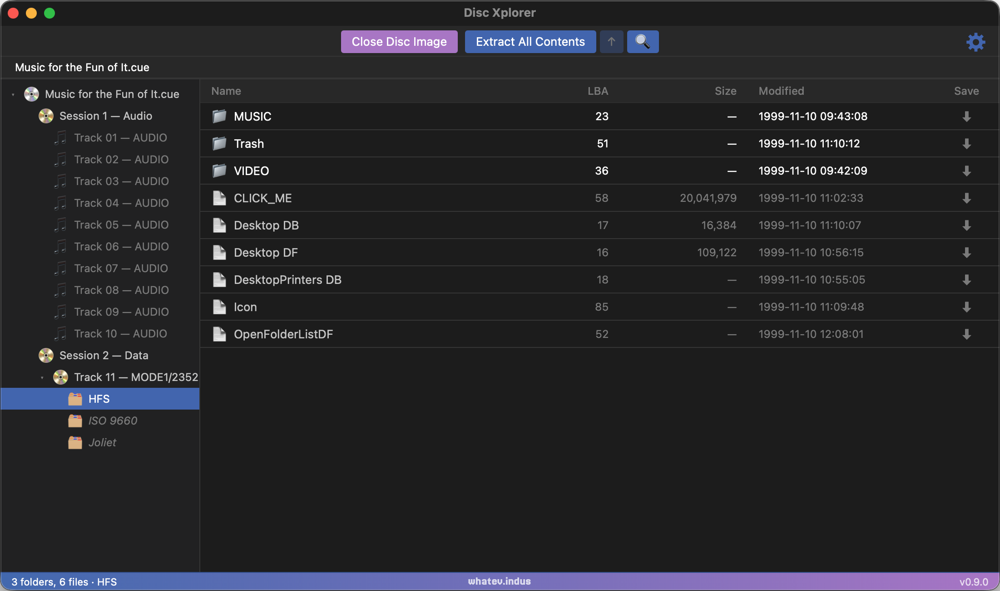

# 💿 Disc Xplorer

A free, open-source disc image browser, extractor, and dumping tool for **Windows, macOS, and Linux**. Browse files, export audio, inspect sectors, and preserve physical discs — no mounting required for image browsing.

[](https://github.com/whatever-industries/disc-xplorer/releases)
[](https://github.com/whatever-industries/disc-xplorer/stargazers)
[](https://github.com/whatever-industries/disc-xplorer/releases/latest)
[](LICENSE)

## 📥 Download

**[Get the latest release](https://github.com/whatever-industries/disc-xplorer/releases/latest)** — Windows (x64 / ARM), macOS (Apple Silicon / Intel), and Linux (x64 / ARM).

The download counter includes files still available across all releases; deleted or replaced builds are excluded.



## ✨ Features

### Browse & extract

- Browse disc images and physical discs; extract individual files, folders, or everything.
- Drag and drop images, including a BIN with a matching CUE, or open associated files directly.
- Batch Extract separates each disc, filesystem, and audio collection into its own folder, using volume labels and CD-TEXT where available.
- Recover deleted files on FAT / FATX; export CD-ROM XA data as file content, with subheaders, or as raw sectors.
- Play audio tracks with continuous playback, track skip, and volume; export **WAV, MP3, or FLAC** with configurable gap handling.

### Dump & preserve

- Dump physical discs with bundled or external [redumper](https://github.com/superg/redumper), live progress, error counters, and logs.
- Refine recoverable dumps, including after restarting the app; browse completed images directly.
- Automatically archive logs as **7z with ZIP fallback** and clean up successful dumps; keep recovery files when refinement is needed.
- Configure drive compatibility, error handling, read speed, retries, offset correction, skeleton output, and auto-eject.
- Optionally double-dump DVD / Blu-ray discs and compare SHA-256 hashes, keeping both copies.
- Edit redumper options directly in **Manual CLI command mode**.

### Inspect & mount

- **Disc Info:** filesystems, tracks, and available ISO header metadata.
- **Sector View:** hex and ASCII inspection, image comparison, and drag-and-drop on either pane.
- **Dates & Times:** disc timestamps and the latest file / folder date.
- **Export File List:** CSV, JSON, TXT, or DFXML.
- Mount images through macOS `hdiutil`, Windows `Mount-DiskImage`, or Linux CDemu; supported formats depend on the platform.

### Convert & organize

- Convert CSO / CISO, ZSO, GCZ, WBFS, WUX / WUD, and GameCube RVZ / WIA to **ISO**; decompress ECM to **BIN**.
- Compress supported images to **CSO / ZSO**, or Wii U ISO / WUD to **WUX**.
- Encrypt or decrypt **PS3 ISO** with a key; extract CD **CHD** to CUE/BIN.
- Merge or split **CUE/BIN** tracks while preserving cue metadata and using Redump track names.
- Queue conversions for a file or folder, with progress and cancellation that removes partial output.

Mixed-mode discs retain their audio tracks rather than being flattened to ISO / CSO. Wii RVZ / WIA can be read but not converted to ISO.

## 🗂️ Supported formats

### Disc & filesystem images

- **Common:** ISO, IMG, CUE/BIN (single- or multi-file), MDS/MDF, MDX, NRG, CCD/IMG/SUB, CDI, GDI, CHD, and ECM.
- **Compressed:** CSO / CISO, ZSO / ZISO, GCZ, RVZ, WIA, and UIF.
- **Console:** WBFS, WUX / WUD, WUA, and encrypted or decrypted PS3 ISO (keys from `.ird`, `.dkey`, or `.key`).
- **Preservation:** BlindWrite BWT / B5T / B6T, CIF, redumper `.sdram` / `.sbram`, `.skeleton` / `.skeleton.zst`, and KryoFlux floppy streams.
- **macOS:** CDR / DMG through `hdiutil`. **AaruFormat** `.aaruf` / DiscImageChef `.dicf` are identified; browsing is not yet implemented.

### Filesystems

- **PC & Mac:** ISO 9660 (Joliet, Rock Ridge, High Sierra, El Torito, and Path Table views), UDF, HFS, PC/Mac hybrids, and FAT12 / FAT16.
- **Xbox:** XDVDFS, FATX, and XTAF.
- **Nintendo:** GameCube / Wii GCM, Wii U (Common Key required for GM decryption), and Nintendo DS Nitro.
- **Other consoles:** 3DO OperaFS, PC Engine / TurboGrafx-16 CD-ROM, and Philips CD-i.

### Archives

- **ZIP:** stored, deflate, bzip2, LZMA, Zstandard, and Zip64.
- **TAR:** plain, gzip, bzip2, xz, or Zstandard.
- **CAB:** uncompressed and MSZIP. **Valve VPK:** v1 / v2, including multi-part archives.

## 🌐 Languages & appearance

Light and dark themes, with **14 interface languages**: English, Español, Français, Deutsch, Italiano, Polski, Українська, Português (Brasil), 简体中文, 日本語, 한국어, हिन्दी, العربية, Русский.

Choose yours in **Settings → General → Language**.

## 💜 Support

As enthusiasts, we want disc preservation tools to be available to everyone. Disc Xplorer is free and open source, with no paid tier or locked formats. Donations and detailed bug reports help us keep improving it — thank you.

<p align="center">
  <a href="https://www.paypal.com/donate/?hosted_button_id=JP2HYZVLTHKX8"></a>
</p>

## 🛠️ Build

Requires Rust (stable), Node.js, and the [Tauri prerequisites](https://tauri.app/start/prerequisites/) for your platform.

```sh
npm install
npm run tauri build
```

For development, run `npm run tauri dev`.

## 📄 License

Disc Xplorer is free software under the **GNU General Public License v3**. See [LICENSE](LICENSE) and [third-party acknowledgments](docs/ACKNOWLEDGMENTS.md). Bundled library notices are also available in the app.
